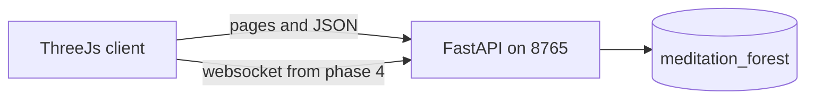

# Forest meditation game

A quiet multiplayer forest. People walk, sit, and watch a place. They never chat, touch, or share a seat. Visual composition is the product. Avatars are stick figures.

This file is the shared design. Build from the phase files, one agent at a time:

1. [01-walkable-grove.md](01-walkable-grove.md)
2. [02-forest-catalog.md](02-forest-catalog.md)
3. [03-sit-and-video.md](03-sit-and-video.md)
4. [04-other-people.md](04-other-people.md)
5. [05-picture-holds.md](05-picture-holds.md)

When this file and a phase file disagree, follow the phase file. Later phases must not rename contracts from earlier phases.

## Decisions

- **Client:** Three.js r170, vendored at `web/vendor/three.module.js`, no bundler, no physics engine, no downloaded models. Geometry is procedural building blocks.
- **Server:** FastAPI plus one uvicorn process on `127.0.0.1:8765`. Presence lives in memory. Two workers would split the world.
- **Database:** a new Postgres 16 used by this game and nothing else. Compose file lives only in this repo. Database `meditation_forest`, user `forest`, password `forest` for local play, host port `127.0.0.1:5436`. Volume `meditation_forest_pg`. No Alembic. Ordered SQL files in `migrations/` applied by a tiny migrator. No connection to customer-support Postgres, Mongo, user accounts, or the main Entourage compose files.
- **World authority for art data:** Python generates spots, scatter, landmarks, and seated recipes. The browser renders JSON. It does not invent a second forest.
- **Walking before phase 4** is local. **Phase 4** makes the server the position authority. The client renders interpolated snapshots and does not predict.
- **YouTube** is a private iframe for the seated player. It is never written into presence snapshots.
- **Website:** `entourage-ai.life/online-meditation.html` is a later embed. This build does not edit the marketing repo.

## How the world works



One unit is one meter. Y is up. The forest is the square `x,z` in `(-200, 200)`. Chunks are 64 m, indexed from the southwest corner:

```python
cx = floor((x - (-200)) / 64)
cz = floor((z - (-200)) / 64)
```

Terrain height is shared through coefficients served by `/api/world/meta`, so the client and server cannot drift:

```python
TERMS = (
    (1.6, 0.020, 0.0, 1.7),
    (1.1, 0.0, 0.017, 0.4),
    (0.45, 0.050, 0.050, 0.0),
    (0.25, 0.090, 0.030, 0.0),
)
def ground_height(x: float, z: float) -> float:
    return sum(a * math.sin(kx * x + kz * z + phase) for a, kx, kz, phase in TERMS)
```

Six rectangular biomes, half-open on the minimum edges so borders have one owner:

- `valley`: x `[-200, 0)`, z `[67, 200]`
- `waterfall_gorge`: x `[0, 200]`, z `[67, 200]`
- `moss_plain`: x `[-200, 0)`, z `[-67, 67)`
- `river`: x `[0, 200]`, z `[-67, 67)`
- `strange_fauna`: x `[-200, 0)`, z `[-200, -67)`
- `cathedral_trees`: x `[0, 200]`, z `[-200, -67)`

Fixed light, not a clock. Moss is morning, cathedral is dim with warm shafts, river is late afternoon, waterfall is bright overcast, valley is clear day, strange fauna is dusk-violet. Fog thickens within 12 m of a biome border.

Spots sit on a hex lattice of **8 m**. That is wider than the 5 m personal radius, so two seated people are always legal.

```python
SPACING = 8.0
ROW_H = 8.0 * math.sqrt(3) / 2
# row, col start at 0
z = -200 + (row + 0.5) * ROW_H
x = -196 + col * 8 + (4 if row % 2 else 0)
```

Keep a point when it is strictly inside the square. Drop it when its biome is `river` and `abs(z - river_z(x)) < 5`. Never nudge a point.

```python
def river_z(x: float) -> float:
    return 6 * math.sin(x * 0.035) + 2.5 * math.sin(x * 0.11)
```

Number surviving points from 1 in row-major order. Expect roughly 2,500 to 3,200 spots, and at least 300 in every biome. `WORLD_SEED = 20261105` changes yaw and recipes only. Terrain coefficients stay fixed.

RNG is mulberry32, 32-bit masked multiplies:

```python
def mulberry32(seed: int):
    a = seed & 0xFFFFFFFF
    def next_f() -> float:
        nonlocal a
        a = (a + 0x6D2B79F5) & 0xFFFFFFFF
        t = a
        t = ((t ^ (t >> 15)) * (t | 1)) & 0xFFFFFFFF
        t = (t ^ ((t + (((t ^ (t >> 7)) * (t | 61)) & 0xFFFFFFFF)) & 0xFFFFFFFF)) & 0xFFFFFFFF
        return (t ^ (t >> 14)) / 4294967296
    return next_f
```

`spot_rng(spot_id)` seeds with `(WORLD_SEED + spot_id * 1013904223) & 0xFFFFFFFF`.

Yaw `0` looks toward `+Z`. Forward is `(sin yaw, cos yaw)`, right is `(cos yaw, -sin yaw)`. Positive `move_z` walks forward. Pitch never moves the body.

Constants live in `forest_server/world/constants.py` and are echoed by `/api/world/meta`. Magic numbers do not get copied into JS.

## Database

`migrations/001_init.sql`:

```sql
CREATE TABLE schema_migrations (
    filename text PRIMARY KEY,
    applied_at timestamptz NOT NULL DEFAULT now()
);

CREATE TABLE spots (
    id integer PRIMARY KEY,
    biome text NOT NULL,
    archetype text NOT NULL,
    x double precision NOT NULL,
    y double precision NOT NULL,
    z double precision NOT NULL,
    yaw double precision NOT NULL,
    chunk_x integer NOT NULL,
    chunk_z integer NOT NULL
);
CREATE INDEX spots_chunk ON spots (chunk_x, chunk_z);

CREATE TABLE sessions (
    id uuid PRIMARY KEY,
    token_hash text NOT NULL UNIQUE,
    color text NOT NULL,
    created_at timestamptz NOT NULL DEFAULT now(),
    last_seen_at timestamptz NOT NULL DEFAULT now(),
    pose jsonb NOT NULL,
    youtube_video_id text
);

CREATE TABLE spot_claims (
    spot_id integer PRIMARY KEY REFERENCES spots (id),
    session_id uuid NOT NULL REFERENCES sessions (id),
    claimed_at timestamptz NOT NULL DEFAULT now()
);
CREATE INDEX spot_claims_session ON spot_claims (session_id);
```

`y` on a spot is `ground_height(x, z)`. Startup inserts spots only when `count(*) = 0`. Claims are the occupancy lock:

```sql
INSERT INTO spot_claims (spot_id, session_id)
VALUES ($1, $2)
ON CONFLICT (spot_id) DO NOTHING
RETURNING spot_id;
```

An empty return means someone else sat first.

Token is `secrets.token_urlsafe(32)`. The database stores SHA-256 hex only. The browser keeps the raw token in `localStorage` under `forest_token`.

## Realtime contract (phase 4)

Websocket at `/ws`. Unknown message types are ignored. Incoming union is exactly `hello`, `input`, `sit`, `stand`, `youtube`, `ping`.

- `hello`: `{type, token|null}`
- `input`: `{type, seq, yaw, pitch, move_x, move_z}` with axes clamped to `[-1, 1]` and normalized if the vector is longer than 1
- `sit`: `{type, spot_id}`
- `stand`: `{type}`
- `youtube`: `{type, video_id|null}` where `video_id` matches `^[A-Za-z0-9_-]{11}$`
- Server tick is **10 Hz**. Speed is **3.2 m/s**. Tick dt is `0.1`, never the client's dt.
- Horizontal distance strictly under **5.0 m** is illegal. Resolve by sliding outward along the away vector, up to 3 iterations, then freeze the tick.
- Sit is accepted only when the spot is unclaimed, horizontal distance to the seat is **<= 2.5 m**, and the seat is at least 5 m from every other live player. Success snaps the sitter to the seat.
- Snapshots go to players within **96 m** and contain `tick`, `you`, `others[{session_id, color, pose}]`, and `claimed_spot_ids`. Pose is `{x,y,z,yaw,pitch,mode,spot_id}` with `mode` of `walk` or `sit`. No display name, no message text, no video id.
- No websocket message for **15 s** deletes the live player and their claim.
- One welcome message may include that player's own `token`, `color`, and `youtube_video_id`.

Colors are muted: hue `(int(uuid.hex[:4], 16) % 90) + 25`, saturation `0.28`, lightness `0.42`.

## Art language

Procedural meshes, vertex colors, `FogExp2`, hemisphere plus one directional light per biome. No shadow maps, no glTF, no gray default materials. Palettes:

- Moss: ground `#6f8f62`, moss `#3e6b45`, mushroom cap `#c4554a`, stem `#efe6d4`, fog `#d5e2d2`, sun `#ffe0b0`
- Cathedral: trunk `#4a382c`, canopy `#1d3328`, shaft `#f3e2b8`, fog `#9aa89a`
- River: water `#6e9aa3`, stone `#8a8178`, reed `#7ea15a`, fog `#d5e4e2`
- Waterfall: rock `#6d7270`, sheet `#c5ddd8`, mist `#ffffff`, fog `#d0ddd8`
- Valley: grass `#8aaa62`, flowers `#d47aa6` and `#e6c85a`, ridge `#9aa7b0`, fog `#e4ecf1`
- Strange: ground `#3a3550`, spiral `#6a4a78`, spore `#d7f28a`, moth `#f2c9ff`, fog `#6a6288`

Kits, origin at the base center: `moss_mound`, `mushroom`, `fern`, `dead_log`, `tree`, `vine_strand`, `boulder`, `river_stone`, `reed`, `pool_disc`, `waterfall_sheet`, `mist_card`, `cliff_wall`, `wildflower`, `ridge_card`, `spiral_tree`, `spore`, `glow_moth`, `lantern_frog`, `seat_cushion`.

`tree` is a tapered trunk plus three canopy blobs. Unscaled height is 10 m. Cathedral scatter uses scale `1.6` to `2.4`. `waterfall_sheet` is a double-sided translucent plane that scrolls UVs. `mist_card` and `spore` and `glow_moth` are additive. Airy kits may cross the view: `mist_card`, `spore`, `glow_moth`, `waterfall_sheet`, `vine_strand`. Solid kits stay out of the body (radius 0.8 m) and out of the forward wedge `|angle| < 0.35` and `r < 4`, except the `behind_sheet` archetype.

Overworld scatter is computed per chunk in Python, about 80 to 180 instances, instanced per kit. Four landmarks are extra blocks, not spots: great fall at `(46, 150)`, cathedral heart at `(80, -140)`, spore well at `(-120, -140)`, west ridge at `(-150, 150)`.

Seated mode fades nearby overworld scatter, keeps the player's own cushion, and fades in the recipe. Recipe positions are local, `+Z` is the gaze, then rotated by spot yaw. Block Y is `ground_height(world) + y_offset`. Motion uses `performance.now()` plus a phase of `0.17 * spot_id` seconds: `sway`, `uv_scroll`, `drift`, `bob`, `path_circle`, `hop`.

The seated camera is at eye height `1.15`, pitch `-4` degrees, plus `1.5` degrees of yaw drift with a 12 s period. Mouse look is off while sitting. Standing returns to the walk camera.

Stick figures are `1.7` m, earth-colored, walk cycle only while speed is above `0.15` m/s, sit pose lerps in `0.6` s. First person hides the local body. Other people are always visible as bodies. There is no jump, run, name, or emote.

Targeting: nearest unclaimed seat within `12` m and `10` degrees of the look direction. Keep that lock until the angle exceeds `18` degrees or the distance exceeds `14` m. `F` within `2.5` m sits. `F` while seated stands. The camera does not auto-orbit.

## Scope boundaries

The shipped game has no accounts, no Entourage JWT, no chat, no shared video, no scenery audio, no mobile build, and no production deploy. Desktop Chromium is the play target. Pointer lock starts after a click on the enter overlay.

## Cloud-agent rules

- Work only in this repo. Git Bash. Virtualenv is `.venv` via `python -m venv .venv` and `source .venv/Scripts/activate`.
- `docker compose up -d` before any DB test. If Docker is missing, stop and report it. Do not swap in SQLite.
- Pure tests must pass without a browser. Run `pytest -q` and `node web/world/check_ground.mjs`.
- Each phase ends playable at `http://127.0.0.1:8765/` and includes a short run section in `README.md`. Keep the original purpose text.
- Commit the phase when its done-when list is true. One commit per phase, message focused on why.
- Do not start the next phase's features early.

Run shape for every phase:

```bash
source .venv/Scripts/activate
docker compose up -d
python -m uvicorn forest_server.app:app --host 127.0.0.1 --port 8765
```

## Phase 1 — A server and one walkable grove

**Playable result:** click the page, look around, walk the moss-and-tree prototype in first or third person. Postgres answers `/health`.

**Files:** `docker-compose.yml`, `.env.example`, `.gitignore`, `requirements.txt` (`fastapi`, `uvicorn[standard]`, `sqlalchemy[asyncio]`, `asyncpg`, `pydantic`, `pydantic-settings`, `pytest`, `pytest-asyncio`, `httpx`), `forest_server/app.py`, `forest_server/config.py`, `forest_server/database/connection.py`, `forest_server/database/migrate.py`, `forest_server/world/constants.py`, `forest_server/world/ground.py`, `forest_server/routers/health.py`, `migrations/001_init.sql`, `web/index.html`, `web/css/forest.css`, `web/vendor/three.module.js`, `web/js/main.js`, `web/js/ground.js`, `web/js/controls.js`, `web/js/kits/materials.js`, `web/js/kits/index.js`, `web/world/check_ground.mjs`, `tests/test_ground.py`, `tests/test_health.py`.

**Build:**

- Compose service `forest_postgres` as decided above, healthcheck `pg_isready -U forest -d meditation_forest`.
- App lifespan runs migrations, then `SELECT 1`.
- `GET /health` returns `{status, db, spots}` with `db` of `ok` or `down`. Static files mount at `/` without swallowing `/health`, `/api`, or `/ws`.
- Enter overlay: "Click to walk into the forest." Hint fades after 5 s: "WASD move · mouse look · V view". Title is `Forest`. Type is a system serif.
- Pointer lock, yaw unlimited, pitch clamped to `-50..70` in first person and `-35..55` in third. Third person camera sits `4.2` m back and `1.8` m up. Eye height `1.55`. `V` toggles view. `Esc` releases the mouse. Movement is camera-relative at `3.2` m/s on the ground height function. Clamp the walker to `[-196, 196]`.
- One 7-by-7 chunk of displaced ground is enough in this phase, vertex-colored with the moss palette, plus about 40 hand-placed kit instances so the material language is real: mounds, red-capped mushrooms, ferns, two 16 m cathedral trunks. Fog and lights use the moss preset. No spot markers yet.
- `check_ground.mjs` prints heights for `(0,0)`, `(10,-4)`, `(-80,120)`, `(199,199)`. `test_ground.py` compares those to Python. `test_health.py` hits the app with httpx and skips only the DB assertion if compose is down, but still checks the route shape.

**Done when:** `/health` reports `db: ok`, the ground test passes, and a person can walk the grove in both cameras.

## Phase 2 — The whole forest and every seat

**Playable result:** walk all six regions, see the river and the four landmarks, and find seat cushions receding through the trees.

**Files:** `forest_server/world/biomes.py`, `forest_server/world/spots.py`, `forest_server/world/scatter.py`, `forest_server/world/recipes.py` (archetype picker only; block layouts arrive in phase 3), `forest_server/database/repository.py`, `forest_server/routers/world.py`, `forest_server/app.py` seed hook, `web/js/meta.js`, `web/js/chunks.js`, `web/js/main.js`, `tests/test_spots.py`, `tests/test_scatter.py`.

**Build:**

- Implement lattice, biome rectangles, river skip, stable ids, yaw, and archetype choice. Four archetypes per biome, names fixed for phase 3: moss `dew_clearing`, `mushroom_ring`, `log_seat`, `mound_overlook`; cathedral `between_roots`, `shaft_clearing`, `hollow`, `vine_nave`; river `bank_stone`, `reed_pocket`, `shallow_bend`, `boulder_island_view`; waterfall `pool_ledge`, `mist_shelf`, `behind_sheet`, `gorge_floor`; valley `terrace_lip`, `flower_bowl`, `ridge_seat`, `amphitheater`; strange `spore_circle`, `spiral_cathedral`, `moth_lane`, `violet_hollow`.
- Seed spots on startup if the table is empty. Seeding twice does not duplicate.
- `GET /api/world/meta` returns extents, chunk size, spacing, exclusion, speeds, ground terms, biome rectangles, river formula, palettes, and kit names.
- `GET /api/world/chunks/{cx}/{cz}` returns spots in that chunk plus scatter and any landmark whose xz falls in the chunk. Scatter counts, accepted only when `biome(x,z)` matches the kit: moss 4 small trees, 40 mounds, 30 ferns, 16 mushrooms, 8 logs, 10 boulders; cathedral 12 large trees, 20 ferns, 8 vines, 6 boulders; river 30 reeds, 24 stones, 10 ferns; waterfall 16 cliffs, 10 boulders, 8 mist cards; valley 20 flowers, 14 mounds, 10 boulders, 6 ridge cards; strange 10 spiral trees, 24 spores, 8 moths, 6 frogs.
- Water mesh: ribbon along `river_z` for `x` in `[0, 200]`, width `9` m, `y = ground_height - 0.35`, UV scroll. Draw it with the chunks that contain those samples.
- Landmarks: great fall is an arc of `cliff_wall` plus 3 sheets at least 8 m tall, a pool, and mist; cathedral heart is 7 trunks of scale `2` on a 10 m radius; spore well is 12 spores and 6 spiral trees; west ridge is 5 large `ridge_card`s.
- Client loads meta, then keeps a 3-by-3 chunk window, builds a 32-by-32 displaced ground per chunk, vertex colors by biome, and `InstancedMesh` per kit. Each spot gets a `seat_cushion`. Crossing a biome changes fog and light over 1.2 s. Border fog adds density within 12 m of a rectangle edge.
- Tests: spot count in range, every biome at least 300, nearest neighbor at least `7.99` m, ids unique and stable across two generations, chunk query matches an in-memory filter, scatter kits are legal, great-fall recipe contains `waterfall_sheet` with height at least 8.

**Done when:** a walk from the moss plain reaches the fall, the cathedral, the grove, and the ridge without a reload, and cushions are visible only for loaded chunks.

## Phase 3 — Sitting and a private video

**Playable result:** lock a cushion, sit, watch a composed scene whose pieces move, play any YouTube video, stand up, and resume the same seat after refresh.

**Files:** `forest_server/world/recipes.py`, `forest_server/routers/session.py`, `web/js/diorama.js`, `web/js/youtube.js`, `web/js/main.js`, `tests/test_recipes.py`, `tests/test_claims.py`.

**Build:**

- `GET /api/world/spots/{id}/recipe` returns the spot, the gaze, and blocks `{kit, variant, x, y, z, rot_y, scale, motion, motion_period, motion_amount}`.
- Composer helpers `arc` and `front` use `spot_rng`. Default filter keeps solid kits out of the body and the forward wedge. `behind_sheet` turns the filter off.
- Archetype layouts, tuples of `(op, kit, count, radius_or_z, center_or_x_spread, spread_unused, scale, y, motion, amount, period)`:
  - `dew_clearing`: arc mushroom 9 at r 3.0 behind; arc fern 12 at r 5.5 behind with sway `0.07` / `5` s; arc mound 6 at r 8; front log at z 3.2, x 1.4
  - `mushroom_ring`: arc mushroom 14 at r 3.2, spread almost a full turn, forward gap; arc fern 8 at r 6
  - `log_seat`: front logs flanking at x `±1.6`, z 2.4; arc fern 10 at r 6; arc mound 5 at r 8
  - `mound_overlook`: large mounds at x `±2.2`, z 1.5, scale 1.8; arc small tree 4 at r 10 behind; open forward
  - `between_roots`: arc tree 4 at r 6, scale 1.8, sides and back; arc fern 8 at r 3.5
  - `shaft_clearing`: arc tree 6 at r 9, scale 2; arc vine 8 at r 6, y 4, sway
  - `hollow`: one tree at x 2.2, z 3, scale 2.2; arc vine 6; arc mushroom 4 behind
  - `vine_nave`: two tree rows at x `±3.5`, z from 2 to 12, four per side, scale 1.7; vines between them
  - `bank_stone`: arc `river_stone` 8 at r 4 in front; arc reed 10 at the sides; `pool_disc` at z 5, scale 3
  - `reed_pocket`: arc reed 16 at r 3.5 with a forward gap; stones behind
  - `shallow_bend`: pool at z 4 scale 4; arc stone 6; arc reed behind
  - `boulder_island_view`: boulder at x -2, z 4, scale 1.8; arc reed 8; open right
  - `pool_ledge`: pool at z 4; sheet at z 7, y 2, scale height 8, `uv_scroll` amount `0.25`; cliffs at x `±4`, z 6; mist bob
  - `mist_shelf`: four mist cards in front, drift; low cliffs; sheet off to x 3, z 6
  - `behind_sheet`: sheet at z 2.2, y 1, large, scroll; pool at z 1; cliffs at x `±3`
  - `gorge_floor`: cliffs close at x `±2.4` from z 1 to z 8; sheet at z 10, y 3; mist
  - `terrace_lip`: ridge cards at z 12, 16, 20 getting larger; flowers at the sides; mounds
  - `flower_bowl`: arc wildflower 18 at r 3.4 with a forward gap
  - `ridge_seat`: ridge cards behind at z -2 as a low wall; open forward; flowers at r 5
  - `amphitheater`: arc ridge 5 at r 11; arc flower 12 at r 4
  - `spore_circle`: arc spore 12 at r 3, bob; arc spiral_tree 5 at r 7; moths `path_circle` amount `1.6` period `14`
  - `spiral_cathedral`: arc spiral 5 at r 6; spores behind, bob
  - `moth_lane`: moths crossing the forward view, drift; spirals at the sides
  - `violet_hollow`: dense spores behind; one spiral at x -2.5, z 4; frogs `hop` at x 2, amount `0.35`, period `6`
- `POST /api/session` with an optional token creates or resumes a session.
- `POST /api/sit` and `POST /api/stand` call the claim SQL. Sit stores pose mode `sit`. A second browser sitting there gets `{ok: false, reason: "taken"}`.
- On sit, fetch the recipe, lerp the camera `0.8` s, fade scatter inside 25 m, play block motion. Hint gains "F sit". YouTube panel appears 1.2 s later: a text field, play, and stop. Accept any 11-character id. Destroy the iframe on stand so audio stops. Persist the id with `POST /api/session/youtube`. Restore the text after refresh and do not autoplay.
- Tests: every archetype returns at least 8 blocks, every kit is known, solid blocks respect the view filter except `behind_sheet`, the same spot id always returns the same JSON, two concurrent `claim_spot` calls produce one winner.

**Done when:** sitting at a moss seat, a gorge seat, and a strange seat shows three different moving compositions, a YouTube video plays only for the sitter, and refresh keeps the claim.

## Phase 4 — Other people, five meters away

**Playable result:** two browsers share one forest. Stick figures are visible. Bodies never come within 5 m. One cushion seats one person. There is no way to speak.

**Files:** `forest_server/realtime/protocol.py`, `forest_server/realtime/simulation.py`, `forest_server/realtime/hub.py`, `web/js/net.js`, `web/js/sticks.js`, `web/js/main.js`, `tests/test_exclusion.py`, `tests/test_protocol.py`.

**Build:**

- `Simulation` holds live poses. `input` applies server dt and the slide rule. Head-on test: players at z `0` and z `20`, yaw `0` and yaw `pi`, 200 ticks of forward input, distance stays `>= 5`. Side test: a walker cannot step inside a sitter's radius. Speed test: holding forward never exceeds `3.2` m per second.
- Hub: one connection per session, last connection wins, heartbeat timeout `15` s releases the claim, startup reloads claims whose sessions were seen within `15` s and seats those poses. Walking poses are not required to survive a restart.
- Sit and stand on the socket use the same `claim_spot` and `release_claim_for_session` functions as HTTP. HTTP sit can remain for tests.
- Welcome returns the raw token once. Snapshots at 10 Hz to the interest radius. Claimed cushions in range are listed.
- Client: keys still produce a move vector, but the rendered body follows snapshot interpolation. Remove local walking integration from the display path. Other sessions are stick figures. Occupied cushions are not targetable. The local sitter still uses the phase 3 camera, diorama, and YouTube panel.
- Protocol test builds a snapshot model and asserts there is no field whose name contains `name`, `chat`, `message`, or `youtube`. A youtube update is stored for the owner and absent from the other player's snapshot.
- Manual check with two profiles: both walk together and stop at an arm's length that is actually 5 m; both press sit on one cushion; the second stays standing; the first person's video does not appear on the second screen.

**Done when:** that two-browser check works against one server process, and `pytest -q` covers exclusion, the claim race, and the snapshot shape.

## Phase 5 — Hold the picture together

**Playable result:** the same two-browser game, with every region readable at a glance, seats that feel arranged, and a stable minute of walking.

**Files:** kit and landmark modules from phases 1–3, `web/css/forest.css`, `README.md`, `tests/test_landmarks.py`. No new gameplay.

**Build:**

- Tune kits so silhouettes read at 30 m: cathedral trunks at least 16 m in scatter, waterfall sheets at least 8 m, valley ridges as tall flat cards, strange spores emissive. Ferns and reeds sway. Moths circle. Frogs hop. Water and falls scroll.
- Seated compositions already come from data; adjust only the tuple numbers when a view is blocked or empty. Keep the view-filter tests passing.
- Instance one mesh per kit per chunk. Dispose geometries when a chunk unloads. Stay on a 3-by-3 window.
- Fade the hint. Keep the enter overlay. No new HUD.
- README: purpose text, run commands, the two-browser check, and one paragraph for the future page. That page will iframe this origin. Building it is outside this repo.
- Restart test: a seated player's claim is restored if the socket returns within `15` s; after the timeout the cushion is free.

**Done when:** two browsers can walk from the moss plain to the great fall and the spore well, sit in different biomes, play a private video, and stand, with `pytest -q` and `node web/world/check_ground.mjs` green.

## What the last phase must feel like

A person clicks once, walks a slow 3.2 m/s through morning moss into a river, and sits. The camera settles. Ferns move. A sheet of water keeps falling the same way for everyone. A stick figure may pass at least five meters off, then be gone. The video in the corner belongs only to the sitter.